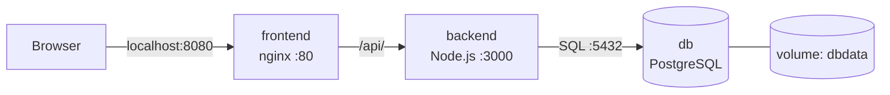

# Docker + GitLab notebook

Refresher for the everyday loop: push repos to GitLab, clone them fresh, check out the newest branch, run the whole stack with Compose. The practice app is a todo list: Node backend, nginx frontend, Postgres.

Labs are ordered so each one builds on the last. Skim the ones you already know, and go straight to the failure table (Lab 7) when something breaks.

## Contents

- [Setup check](#setup-check)
- [Mental model](#mental-model)
- [Lab 1: GitLab for GitHub people](#lab-1-gitlab-for-github-people)
- [Lab 2: Single containers](#lab-2-single-containers)
- [Lab 3: The backend Dockerfile](#lab-3-the-backend-dockerfile)
- [Lab 4: Doing by hand what Compose does](#lab-4-doing-by-hand-what-compose-does)
- [Lab 5: Full stack with Compose](#lab-5-full-stack-with-compose)
- [Lab 6: Fresh clone, newest branch](#lab-6-fresh-clone-newest-branch)
- [Lab 7: Breaking things on purpose](#lab-7-breaking-things-on-purpose)
- [Command reference](#command-reference)
- [Next](#next)

## Setup check

You need Docker (with the Compose plugin), Git, and a GitLab account with an SSH key.

```sh
docker --version
docker compose version
git --version
ssh -T git@gitlab.com        # expect: Welcome to GitLab, @<username>!
```

If the key isn't set up yet:

```sh
ssh-keygen -t ed25519 -C "you@example.com"
cat ~/.ssh/id_ed25519.pub    # paste into GitLab > Preferences > SSH Keys
```

| Symptom | Usual cause |
| --- | --- |
| `Cannot connect to the Docker daemon` | Docker Desktop isn't running yet |
| `Permission denied (publickey)` | Key not added to GitLab, or the private key got pasted instead of the `.pub` |

On Windows, let Docker Desktop enable WSL 2 when it asks. On Linux, install Docker Engine plus the Compose plugin.

## Mental model

- **Dockerfile** builds an **image**. A **container** is a running image. Containers are disposable.
- A container's filesystem disappears with it. Anything worth keeping goes in a **volume**.
- Every container has its own network identity. Inside the backend, `localhost` is the backend, not your laptop.
- On a shared network, containers find each other by name. The backend reaches Postgres at `db:5432`.

| Term | In this project |
| --- | --- |
| Dockerfile | `backend/Dockerfile`, `frontend/Dockerfile` |
| Image | `todo-backend`, `postgres:16-alpine` |
| Container | The three services `docker compose up` starts |
| Volume | `dbdata`, holds the Postgres files |
| Network | Compose creates one, services resolve by name |
| Compose file | `docker-compose.yml` |

## Lab 1: GitLab for GitHub people

Goal: two private projects, `todo-backend` and `todo-frontend`.

| GitHub | GitLab |
| --- | --- |
| Repository | Project |
| Organization | Group |
| Pull request | Merge request |
| Actions (`.github/workflows`) | Pipelines (`.gitlab-ci.yml`) |

Create both as blank projects, visibility **Private**, with **Initialize repository with a README** unchecked. They need to start empty so the first push doesn't conflict.

Then, in `backend/` and again in `frontend/`:

```sh
git init -b main
git add .
git commit -m "Initial backend"
git remote add origin git@gitlab.com:<username>/todo-backend.git
git push -u origin main
```

Check: each project page lists its files, and `node_modules` isn't there (`.gitignore` handles it).

- `remote origin already exists`: `git remote remove origin`, then add it again.
- `repository not found`: typo in the username or project name.

### Aside: nested repos (a repo inside a repo)

Situation: `sample-app/` is itself a git repo, and `backend/` and `frontend/` each have their own `.git` inside it. When you `git add .` in the parent, git doesn't add their files. It records each folder as a single **gitlink**, a pointer to one commit of the inner repo, and warns `adding embedded git repository`. On GitLab the parent shows `backend` and `frontend` as empty, unclickable entries.

Pick one of two ways out.

**Option A: keep them as separate repos** (what Lab 1 does). Don't track them from the parent. Add them to the parent's `.gitignore`:

```sh
echo "backend/" >> .gitignore
echo "frontend/" >> .gitignore
```

**Option B: fold them into the parent as one repo** (a monorepo). Run these two commands from `sample-app/`:

```sh
# delete the inner git metadata, so backend/ and frontend/ become plain folders
# (the code stays; the inner commit history and remotes are gone for good)
rm -rf backend/.git frontend/.git

# remove the gitlink pointers from the parent's index (--cached = index only, files on disk untouched)
git rm --cached backend frontend
```

Then stage the real files and commit:

```sh
git add .
git commit -m "Track backend and frontend in the parent repo"
```

Why both commands, and in this order:

- `rm -rf backend/.git frontend/.git` is what stops the folders being repos. Until the `.git` directories are gone, git keeps treating them as embedded repos.
- `git rm --cached backend frontend` clears the stale gitlink entries (mode `160000`) from the index. Skip it and `git add .` can leave the old pointers in place instead of the file contents. `--cached` means nothing on disk is deleted. No `-r` is needed because a gitlink is a single entry.
- Check `git ls-files -s backend | head` afterwards. You want `100644` lines for each file, not a single `160000` line.

Before you run `rm -rf`:

- It is irreversible. Make sure the inner repos are pushed (`git status` and `git log origin/main..` inside each) or you have no use for their history.
- Run it from `sample-app/`, and check the paths. A typo with `rm -rf` has no undo.
- Don't use Option B if you want separate GitLab projects, as in the Lab 6 flow of cloning `todo-backend` and `todo-frontend` into `backend/` and `frontend/`. Use Option A there.

## Lab 2: Single containers

Goal: get comfortable with run, inspect, remove. No project files needed.

```sh
docker run hello-world
docker run -d -p 8081:80 --name web nginx:alpine
```

Open http://localhost:8081, then:

```sh
docker ps
docker logs web
docker images
docker stop web && docker rm web
```

| Flag | Meaning |
| --- | --- |
| `-d` | Detached, runs in the background |
| `-p 8081:80` | `host:container` port mapping |
| `--name web` | A name instead of a random ID |

`port is already allocated` means something else owns that host port. Change the left side, e.g. `-p 8082:80`.

## Lab 3: The backend Dockerfile

| Instruction | What it does |
| --- | --- |
| `FROM node:20-alpine` | Small base image with Node 20 |
| `WORKDIR /app` | Working directory inside the image |
| `COPY package*.json ./` | Copy manifests first |
| `RUN npm install --omit=dev` | Install prod deps at build time |
| `COPY . .` | Copy the rest of the source |
| `EXPOSE 3000` | Documentation only, doesn't publish anything |
| `CMD ["npm", "start"]` | Default start command |

Manifests are copied and installed before the source so the install layer stays cached. Edit a source file and the rebuild skips `npm install`.

Frontend side: a small nginx image with two files copied in. The line that matters in `nginx.conf` is `proxy_pass http://backend:3000;`, which sends `/api/` to the container named `backend`. `.dockerignore` keeps `node_modules` and `.git` out of the build context.

Quick check: deleting `EXPOSE 3000` changes nothing here. Connectivity comes from the network and published ports, not `EXPOSE`.

## Lab 4: Doing by hand what Compose does

Worth doing once so the Compose file stops feeling like magic.

Backend alone:

```sh
cd backend
docker build -t todo-backend .
docker run --rm todo-backend
```

It logs `DB not ready (attempt n/10)` on repeat. That's fine. The app is healthy and just has no database. Ctrl+C out.

Now give it a database on a shared network:

```sh
docker network create todo-net

docker run -d --name db --network todo-net \
  -e POSTGRES_USER=app -e POSTGRES_PASSWORD=secret -e POSTGRES_DB=appdb \
  postgres:16-alpine

docker run -d --name backend --network todo-net -p 3000:3000 \
  -e DATABASE_URL=postgres://app:secret@db:5432/appdb \
  todo-backend
```

The `db` in the connection string is the first container's name.

```sh
curl localhost:3000/api/health
curl -X POST localhost:3000/api/todos -H "Content-Type: application/json" -d '{"title":"learn docker"}'
curl localhost:3000/api/todos
```

Expect `{"status":"ok"}`, the new todo with an `id`, then a list containing it. `docker logs backend` should show `Database ready`.

Cleanup:

```sh
docker rm -f backend db
docker network rm todo-net
```

- `container name already in use`: a leftover from last time, so `docker rm -f backend db`.
- Backend stuck on `DB not ready`: check both containers have `--network todo-net`.

That was one network, two long commands, and a pile of flags. Compose collapses it into one file.

## Lab 5: Full stack with Compose



The browser only talks to the frontend. nginx proxies `/api/` to the backend, and the backend talks to Postgres. Only the frontend publishes a host port.

| Key | Meaning |
| --- | --- |
| `build: ./backend` | Build from the Dockerfile in that folder |
| `image: postgres:16-alpine` | Use a prebuilt image |
| `environment:` | Settings passed into the container |
| `ports: "8080:80"` | Publish container port 80 on host 8080 |
| `depends_on:` | Start order only, not readiness. This is why the backend retries its DB connection |
| `volumes: dbdata` | Named volume that survives the container |

Run it from the folder that holds `backend/`, `frontend/` and `docker-compose.yml`:

```sh
docker compose up --build
```

First run takes a few minutes. When the logs settle, open http://localhost:8080 and add some todos. Detached version:

```sh
docker compose up -d
docker compose ps
docker compose down
```

Expect `db-1`, `backend-1` and `frontend-1` log prefixes, plus `Database ready` and `Backend listening on port 3000`. Todos should survive a page refresh.

- `no such file or directory` mentioning `./backend`: the compose file isn't next to the cloned folders.
- Page loads but todos fail: `docker compose logs backend`.

## Lab 6: Fresh clone, newest branch

Scenario: the repo has several branches and you want the one that was worked on most recently, on a machine that has nothing yet.

### What git actually does

- `git clone` downloads **every** branch, but only checks out one: the project's default branch (usually `main`).
- The other branches arrive as **remote-tracking refs**, named `origin/<branch>`. You can see them, but you aren't on them.
- "Newest branch" means the branch whose last commit is the most recent. Git doesn't have a built-in "latest" flag, so you sort by commit date.
- `git checkout <branch>` (no `origin/`) creates a local branch from the matching `origin/<branch>` and switches to it.

### Fast path: the team tells you the branch name

If the dev team says "use `beta`", skip the sorting. Confirm the exact name exists on the remote first, since the real branch could be `beta`, `release/beta`, `beta-2` and so on:

```sh
git ls-remote --heads git@gitlab.com:<username>/todo-backend.git | grep -i beta
```

Each line ends in `refs/heads/<name>`. Whatever follows `refs/heads/` is the name to use. Then clone straight onto it, in both repos:

```sh
# go to the parent folder that will hold both repos and the compose file
cd ~/practice/myapp

# clone the backend repo and check out the beta branch (-b), into a folder named "backend"
git clone -b beta git@gitlab.com:<username>/todo-backend.git backend

# same for the frontend, into a folder named "frontend"
git clone -b beta git@gitlab.com:<username>/todo-frontend.git frontend

# copy the compose file next to the two folders (the trailing . means "here")
cp /path/to/sample-app/docker-compose.yml .

# build the images from the beta code and start db, backend and frontend
docker compose up --build
```

Already cloned `main` and want to switch instead:

```sh
# move into the repo you already cloned
cd backend

# download the latest list of branches and commits from GitLab, without changing your files
git fetch --all

# switch to beta; git creates a local beta branch that tracks origin/beta
git checkout beta

# confirm which branch you are on now
git branch --show-current     # beta
```

Single branch only (downloads just the history of `beta`, not the other branches):

```sh
# -b beta            check out beta
# --single-branch    fetch only beta's history, skip every other branch
git clone -b beta --single-branch git@gitlab.com:<username>/todo-backend.git backend
git clone -b beta --single-branch git@gitlab.com:<username>/todo-frontend.git frontend

# verify: only origin/beta (plus the HEAD pointer) should be listed
cd backend && git branch -r
```

Trade-off: with `--single-branch`, `git fetch --all` won't discover other branches later. To pull another one in, run `git remote set-branches --add origin main` and then `git fetch origin`.

Notes:

- Plain `-b beta` still downloads all branches, it just checks out `beta` instead of `main`. See the single-branch example above if you want only that one.
- If only one repo has a `beta` branch, `-b beta` fails on the other one with `Remote branch beta not found`. Clone that one normally and ask the team which branch it should be on.
- `-b` also accepts a tag, so if "beta" turns out to be a tag you'll land in detached HEAD. Check with `git ls-remote --tags <url>`.

### Setup: give the repo some branches

Skip this if your repo already has several. Otherwise, from a working copy of `backend/`:

```sh
git checkout -b feature/old-work
git commit --allow-empty -m "older branch"
git push -u origin feature/old-work

git checkout main
git checkout -b feature/health-version
# edit server.js: health returns { status: "ok", version: 2 }
git commit -am "Add version to health check"
git push -u origin feature/health-version
```

`feature/health-version` now has the newest commit.

### Steps

**1. Clone into a clean folder.** The trailing name must match what the compose file expects (`./backend`, `./frontend`).

```sh
mkdir -p ~/practice/myapp && cd ~/practice/myapp
git clone git@gitlab.com:<username>/todo-backend.git backend
git clone git@gitlab.com:<username>/todo-frontend.git frontend
cp /path/to/sample-app/docker-compose.yml .
```

You are now on `main` in both repos.

**2. List the remote branches.**

```sh
cd backend
git branch -r
```

```
  origin/HEAD -> origin/main
  origin/feature/health-version
  origin/feature/old-work
  origin/main
```

`origin/HEAD -> origin/main` is just a pointer to the default branch. Ignore it.

**3. Sort them by last commit date, newest first.**

```sh
git for-each-ref --sort=-committerdate refs/remotes/origin \
  --format='%(committerdate:short)  %(refname:strip=3)' | grep -v ' HEAD$'
```

```
2026-11-09  feature/health-version
2026-11-08  feature/old-work
2026-11-02  main
```

The top row is the newest branch. `strip=3` drops `refs/remotes/origin/`, so you get the name you can paste straight into `checkout`.

**4. Switch to it.**

```sh
git checkout feature/health-version
```

Git replies with `branch 'feature/health-version' set up to track 'origin/feature/health-version'`. Use the bare name, not `origin/feature/health-version`. The `origin/` form puts you in detached HEAD.

**5. Confirm where you are.**

```sh
git branch --show-current     # feature/health-version
git log -1 --format='%h %an %ad %s'
```

**6. Repeat for the frontend if it has branches too.** Each repo has its own history, so the newest branch in `frontend` may be a different name, or just `main`.

```sh
cd ../frontend
git for-each-ref --sort=-committerdate refs/remotes/origin \
  --format='%(committerdate:short)  %(refname:strip=3)' | grep -v ' HEAD$'
git checkout <name-from-top-row>
cd ..
```

**7. Run it.**

```sh
docker compose up --build
curl localhost:8080/api/health     # {"status":"ok","version":2}
```

Check out `main` in `backend/`, run `docker compose up --build` again, and `version` disappears. Same command, different code.

### Shortcuts

One command that prints just the newest branch name:

```sh
git for-each-ref --sort=-committerdate refs/remotes/origin \
  --format='%(refname:strip=3)' | grep -v '^HEAD$' | head -1
```

Use it directly:

```sh
git checkout "$(git for-each-ref --sort=-committerdate refs/remotes/origin \
  --format='%(refname:strip=3)' | grep -v '^HEAD$' | head -1)"
```

If you already know the branch name, clone straight onto it:

```sh
git clone -b feature/health-version git@gitlab.com:<username>/todo-backend.git backend
```

Prefer the browser? In GitLab, **Code > Branches** has a sort dropdown. Pick **Updated date** to see the newest branch first. It only helps you find the name, you still check it out with git.

### Later: pulling in new branches

Someone pushes a new branch after you cloned. Your clone doesn't know yet.

```sh
git fetch --all --prune       # --prune drops refs to branches deleted on the remote
```

Then repeat steps 3 and 4. To update the branch you're already on, `git pull`.

### Common issues

| Symptom | Cause / fix |
| --- | --- |
| Branch you expect isn't in `git branch -r` | You haven't fetched since it was pushed. `git fetch --all` |
| `pathspec '<name>' did not match` | Typo, or you included `origin/`, or the branch isn't fetched yet |
| `HEAD detached at origin/...` | You checked out `origin/<name>`. Run `git checkout <name>` instead |
| Sorted list puts `main` first | `main` really was committed to most recently, or the clock on the commit is off |
| Change doesn't show in the app | Ran `up` without `--build`, so the old image was reused |
| `checkout` refuses with local changes | Commit or `git stash` first, then switch |

## Lab 7: Breaking things on purpose

Cause each one, read the output, then undo it.

| Experiment | What you see | Why / fix |
| --- | --- | --- |
| `docker compose stop backend`, reload page | 502 Bad Gateway | nginx is fine, its upstream is down. `docker compose start backend` |
| Two services on host port 8080 | `port is already allocated` | One owner per host port. Change the host side, e.g. `"8090:80"` |
| Edit `server.js`, `up` with no `--build` | Change doesn't appear | Old image reused. Add `--build` |
| Change only `POSTGRES_PASSWORD` | Backend auth failure | Postgres sets the password when the volume is first created. `down -v`, then start again |
| Backend `DATABASE_URL` host set to `localhost` | `DB not ready` forever | `localhost` is the backend itself. Use `db` |
| Quit Docker Desktop, run any `docker` command | `Cannot connect to the Docker daemon` | Engine isn't running. Start Docker Desktop |

First three commands to reach for:

```sh
docker compose ps
docker compose logs backend
docker compose logs -f
```

Persistence check: add a todo, `docker compose down`, then `up -d`. The todo is still there. Now `down -v` and `up -d`: empty list, because the volume is gone.

## Command reference

Git:

```sh
git clone <url> <dir>            # clone into a named folder
git fetch --all                  # refresh all remote refs
git branch -r                    # list remote branches
git checkout <branch>            # switch
git checkout -b <new-branch>     # create and switch
git push -u origin <branch>      # first push of a branch
```

Single containers:

```sh
docker build -t <name> .
docker run -d -p 8081:80 --name web <image>
docker ps                        # add -a for stopped ones
docker logs <name>
docker stop <name> && docker rm <name>
docker images
```

Compose:

```sh
docker compose up --build        # build, then run in the foreground
docker compose up -d             # background
docker compose ps
docker compose logs -f <service>
docker compose exec db psql -U app appdb
docker compose down              # remove containers, keep volumes
docker compose down -v           # also delete volumes (wipes the DB)
```

## Next

- Move credentials into an untracked `.env` file.
- Add a dev override file (bind mounts so code changes don't need a rebuild).
- Add a `.gitlab-ci.yml` that builds both images on every push.
- Swap `depends_on` for a Postgres `healthcheck` with `condition: service_healthy`.
